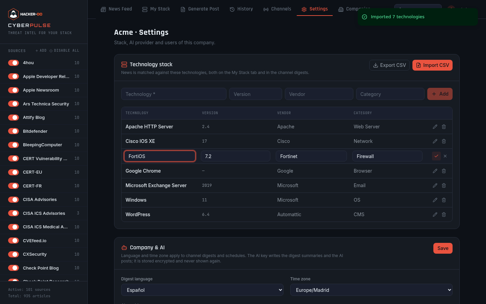
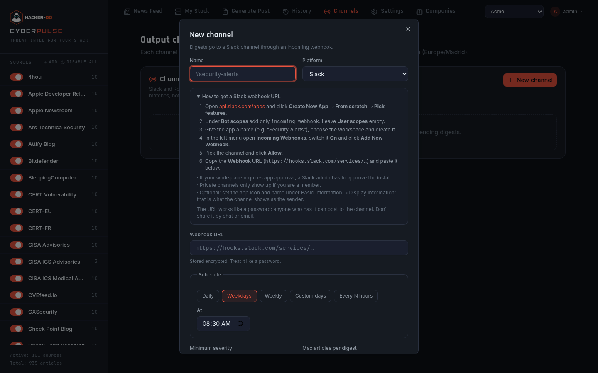

<p align="center">
  
</p>

<h1 align="center">Hacker-Do CyberPulse</h1>

<p align="center">Inteligencia de amenazas a la medida del stack tecnológico de cada cliente, entregada en Slack o Rocket.Chat.</p>

<p align="center">
  
</p>

---

## Qué hace

CyberPulse lee más de 100 fuentes de ciberseguridad (CISA, CERTs nacionales, fabricantes, medios especializados y bases de exploits) y cruza cada noticia con la lista de tecnologías que usa cada cliente. A cada cliente le llega a su canal de Slack o Rocket.Chat un resumen periódico con solo lo que le afecta, ordenado por severidad y con un resumen ejecutivo escrito por IA (Claude u OpenAI).

Es una plataforma **multiempresa**: Hacker-Do da de alta a cada cliente como una empresa, y cada una tiene su propio stack, su propia API key de IA, sus canales y sus horarios, completamente aislados del resto.

### Flujo de trabajo

1. **Hacker-Do crea la empresa** y su primer usuario administrador.
2. **El cliente carga su stack**, a mano o importando un CSV.
3. **Configura uno o más canales** (Slack o Rocket.Chat), con su horario y severidad mínima.
4. **CyberPulse envía el digest** en cada horario, solo con las noticias nuevas que afectan a ese stack. Si no hay nada nuevo, no envía nada.

> Las capturas de este README son de la misma versión desplegada en `cyberpulse.hacker-do.es`, con una empresa de demostración y feeds reales; no contienen datos de clientes.

## Recorrido por la aplicación

### Acceso seguro

<p align="center"></p>

Cada usuario entra con su usuario y contraseña, con 2FA opcional (Google o Microsoft Authenticator, 1Password…). Tras 5 intentos fallidos (contraseña o código 2FA) la cuenta se bloquea 15 minutos, también si los intentos llegan en paralelo. Hay tres roles:

| Rol | Puede |
|---|---|
| `superadmin` (Hacker-Do) | Crear, renombrar, desactivar y borrar empresas, y entrar a gestionar cualquiera de ellas. |
| `admin` (del cliente) | Gestionar el stack, la IA, los canales y los usuarios de su empresa. |
| `member` (del cliente) | Leer noticias y generar posts. Solo lectura sobre la configuración. |

### Feed de noticias

La pestaña **News Feed** (imagen de arriba) muestra todas las noticias recolectadas, con filtros por ventana de tiempo (24 h, 7 días, 30 días) y por categoría (vulnerabilidad, exploit, malware, data breach, phishing, compliance…), orden por relevancia, tendencia, fecha, severidad o fuente, y búsqueda libre. Las fuentes se activan o desactivan desde el panel lateral, y se pueden agregar fuentes RSS propias.

La pestaña **My Stack** muestra solo las noticias que afectan a las tecnologías de la empresa, con indicadores de cuántos artículos coinciden y cuál es la categoría más frecuente. El cruce exige coincidencia de palabra completa: "Go" no coincide con "governments", y los nombres ambiguos (Chrome, Windows, Office…) necesitan contexto. El fabricante suma relevancia, pero por sí solo no alcanza para una coincidencia.

### Stack tecnológico

<p align="center"></p>

En **Settings → Technology stack**, el admin de cada empresa carga sus tecnologías (tecnología, versión, fabricante y categoría):

- **Alta individual** desde el formulario superior.
- **Importación CSV** con vista previa antes de confirmar, en modo *añadir* o *reemplazar*. Acepta coma, punto y coma (Excel en español) o tabulador, y cabeceras en inglés o español.
- **Edición en línea:** el lápiz convierte la fila en campos editables; Enter guarda y Esc cancela.
- **Exportación CSV** protegida contra inyección de fórmulas.

En la misma pantalla se configura el **idioma del digest** (español o inglés), la **zona horaria** de la empresa, el **proveedor de IA** con su API key (se guarda cifrada y nunca vuelve al navegador) y los **usuarios** de la empresa.

### Canales de entrega

<p align="center"></p>

En **Channels** cada empresa define uno o más destinos:

- **Slack o Rocket.Chat** por webhook entrante, con la guía paso a paso dentro del propio diálogo.
- **Horario:** diario, días hábiles, semanal, días a elección a una hora fija, o cada N horas, siempre en la zona horaria de la empresa (con cambio de horario incluido).
- **Severidad mínima** y **máximo de artículos** por envío.
- **Cabecera y pie personalizados** (con `{company}` y `{count}`), para que el mensaje lleve la identidad del cliente.
- Botones **Test** (mensaje de prueba) y **Send now**, más el **historial de envíos** de cada canal.

El digest agrupa las noticias por severidad, nunca repite un artículo en el mismo canal y, si no hay novedades, no se envía.

### Posts e historial

**Generate Post** redacta, a partir de una noticia, un post listo para publicar, eligiendo formato, tono, extensión e idioma. **History** guarda los posts generados para copiarlos o reutilizarlos.

## Puesta en marcha (Docker)

```bash
cd app
cp .env.example .env
# Editar .env: CYBERPULSE_SECRET=$(openssl rand -hex 32) y el primer superadmin
docker compose up -d --build
```

Abrir `http://localhost:3001`, entrar con el superadmin, y en **Companies → New company** crear la primera empresa con su admin. Después borrar `CYBERPULSE_ADMIN_PASSWORD` del `.env`.

> **Importante:** guardá una copia de `CYBERPULSE_SECRET`. Sin él no se pueden descifrar las API keys, los webhooks ni los secretos 2FA guardados.

Por defecto el puerto solo escucha en `127.0.0.1`; publicalo detrás de un reverse proxy con HTTPS (Traefik, Cloudflare Tunnel) y poné `TRUST_PROXY=1`. Para probar en una LAN por `http://IP:3001`: `CYBERPULSE_BIND=0.0.0.0` y `CYBERPULSE_PLAIN_HTTP=true`.

La base de datos se migra sola al arrancar. Una base creada por versiones anteriores (esquema v10) se convierte automáticamente la primera vez, dejando una copia `cyberpulse.pre-drizzle-<fecha>.db` junto al archivo original.

### CLI de operador

```bash
docker exec -it cyberpulse npx tsx server/cli.ts create-superadmin <usuario>
docker exec -it cyberpulse npx tsx server/cli.ts set-password <usuario>
docker exec -it cyberpulse npx tsx server/cli.ts reset-totp <usuario>
docker exec -it cyberpulse npx tsx server/cli.ts list-users
```

## Configurar un canal

El diálogo **Channels → New channel** trae la guía paso a paso de cada plataforma. En resumen:

**Slack**
1. En [api.slack.com/apps](https://api.slack.com/apps): **Create New App → From scratch → Pick features**.
2. En **Bot scopes** agregar solo `incoming-webhook`; **User scopes** vacío.
3. Ponerle nombre (p. ej. "Security Alerts"), elegir el workspace y crearla.
4. **Incoming Webhooks → On → Add New Webhook**, elegir el canal y **Allow**.
5. Copiar la URL `https://hooks.slack.com/services/…` y pegarla en CyberPulse.

Si el workspace exige aprobación de apps, un admin de Slack tiene que aprobarla. Los canales privados solo aparecen si sos miembro.

**Rocket.Chat**
1. Con un usuario que pueda gestionar integraciones: **Administration → Integrations → New → Incoming**.
2. **Enabled** activado, un nombre, **Post to Channel** (`#security-alerts`) y **Post as** un usuario existente que sea miembro del canal (un bot o `rocket.cat`). **Script** desactivado.
3. **Save** y copiar la *Webhook URL* (`https://chat.ejemplo.com/hooks/…`).

El servidor Rocket.Chat tiene que ser accesible por HTTPS. Si está en una red privada, activar `CYBERPULSE_ALLOW_PRIVATE_WEBHOOKS=true`.

Después de crear el canal, **Test** envía un mensaje de prueba con la cabecera y el pie configurados.

## Formato del CSV

```csv
technology,version,vendor,category
WordPress,6.4,Automattic,CMS
FortiOS,7.2,Fortinet,Firewall
PHP,8.2,,Runtime
```

Solo `technology` es obligatoria. También se aceptan las cabeceras `tecnología`, `versión`, `fabricante`/`proveedor`, `categoría`/`tipo`, o un archivo sin cabecera en ese orden. Máximo 2000 filas / 1 MB. La plantilla se descarga desde el diálogo de importación.

## Seguridad

- Secretos de empresa (API keys de IA, URLs de webhook, semillas TOTP) cifrados con AES-256-GCM; en producción el servidor no arranca sin `CYBERPULSE_SECRET`.
- Aislamiento por empresa aplicado en cada consulta del backend (`tenant_id`), cubierto por tests end-to-end.
- Webhooks con protección SSRF: solo `https`, sin redirecciones, y resolución DNS propia que solo acepta direcciones unicast públicas (clasificadas con [ipaddr.js](https://github.com/whitequark/ipaddr.js) según los registros de IANA: se rechazan privadas, loopback, link-local y metadata de la nube, CGNAT, y formas IPv6 que esconden una IPv4 como NAT64 y 6to4). La conexión va a la IP ya validada.
- El bloqueo de login y el anti-replay del 2FA se aplican con actualizaciones atómicas en la base, así que no se pueden esquivar con requests en paralelo.
- El contenido de los feeds se trata como no confiable: se escapa en Slack/Rocket.Chat (no puede inyectar `@channel` ni enlaces), y del resumen de IA se eliminan URLs, así que los enlaces del digest salen siempre de la base de datos.
- Rate limiting en login, escrituras y envíos manuales; CSP estricta con helmet.

## Desarrollo

```bash
cd app
npm install
npm run dev              # API en :3001 + Vite en :3000
npm test                 # tests unitarios + end-to-end multiempresa
npm run typecheck:server
npm run build
```

Variables de entorno: ver [`app/.env.example`](app/.env.example).

### Arquitectura del backend

El servidor (`app/server/`) está organizado en capas; cada una depende solo de las de abajo:

| Capa | Carpeta | Responsabilidad |
|---|---|---|
| API | `api/` | Todos los endpoints y sus guardas (`routes.ts`); middlewares de autenticación, CSRF, CORS, rate limits y errores |
| Controllers | `controllers/` | Leen y validan el request, llaman a un caso de uso o servicio y arman la respuesta |
| Casos de uso | `useCases/` | Flujos que cruzan varios servicios: login, alta de empresa, importación CSV, envío del digest de un canal |
| Servicios | `services/` | Lógica de negocio: autenticación, matcher de stack, digest, scraper, proveedores de IA, webhooks, horarios |
| Repositorios | `repositories/` | Todo el acceso a la base, un módulo por entidad, con el query builder de Drizzle |
| Base de datos | `db/` | Esquema (`schema.ts`), conexión y migraciones |
| Jobs | `jobs/` | Scrape programado, scheduler de canales y retención |

### Base de datos y migraciones

SQLite con [Drizzle ORM](https://orm.drizzle.team). El esquema se define en `server/db/schema.ts`; los cambios se convierten en migraciones SQL con [drizzle-kit](https://orm.drizzle.team/docs/kit-overview) y se aplican solas al arrancar:

```bash
# después de editar server/db/schema.ts
npm run db:generate -- --name agregar_algo   # escribe server/db/migrations/NNNN_agregar_algo.sql
npm run db:check                             # valida el historial de migraciones
```

### Event loop

Node ejecuta todo el JavaScript en un solo hilo, así que el servidor evita trabajo sincrónico largo en el camino de los requests: el hash de contraseñas corre en el thread pool de libuv (scrypt asíncrono), los feeds RSS se descargan y parsean en worker threads, los recorridos sobre muchos artículos ceden el event loop entre tandas, y los resultados de My Stack se cachean por empresa hasta que cambian las noticias o el stack. `GET /api/health` informa el retraso del event loop (`eventLoopDelay`: p50, p99 y máximo en ms) para poder monitorearlo en producción.

## Créditos y licencia

Basado en [CyberPulse](https://github.com/safernandez666/CyberPulse) de **Santiago Fernández**, publicado bajo licencia MIT. Esta versión agrega la plataforma multiempresa, autenticación, canales, programación, importación CSV, integración con Claude y la identidad de Hacker-Do, y quita la integración con LinkedIn. Ver [`LICENSE`](LICENSE) y [`NOTICE`](NOTICE). La documentación original está en [`docs/upstream/`](docs/upstream/).
