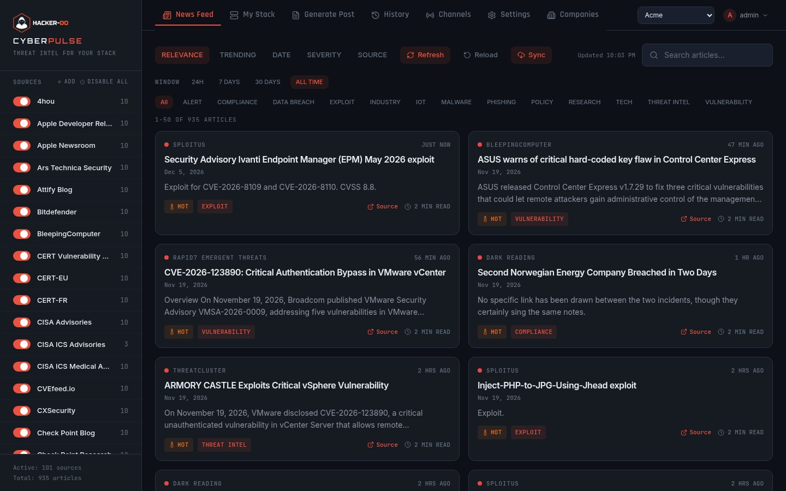
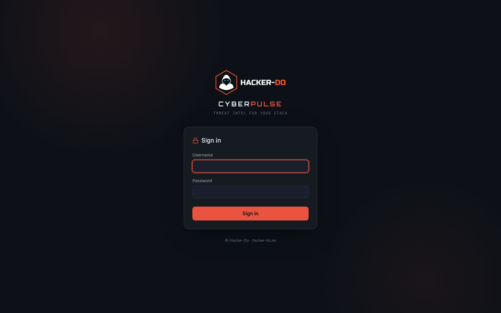
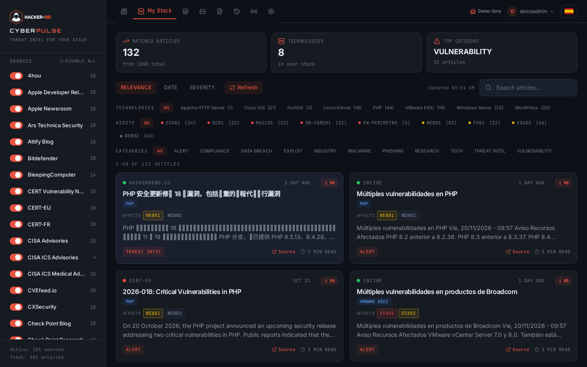
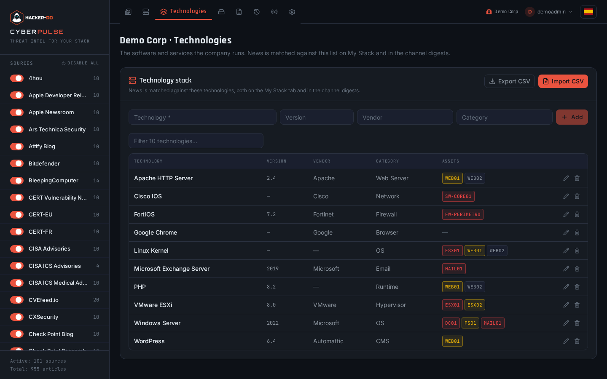
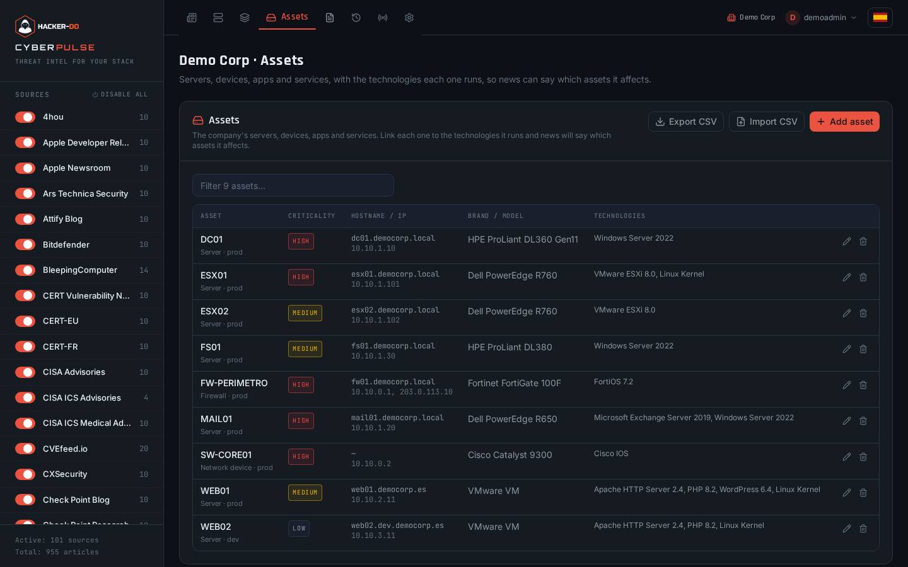

<p align="center">
  
</p>

<h1 align="center">Hacker-Do CyberPulse</h1>

<p align="center">Inteligencia de amenazas a la medida del stack tecnológico y los activos de cada cliente, entregada en Slack, Rocket.Chat, Telegram, Discord, email o LinkedIn.</p>

<p align="center">
  
</p>

---

## Qué hace

CyberPulse lee más de 100 fuentes de ciberseguridad (CISA, CERTs nacionales, fabricantes, medios especializados y bases de exploits) y cruza cada noticia con las tecnologías que usa cada cliente y con los activos que las corren. A cada cliente le llega a sus canales un resumen periódico con solo lo que le afecta, ordenado por severidad, con un resumen ejecutivo escrito por IA (Claude u OpenAI) y, si lo pide, la lista de activos afectados por cada noticia.

Es una plataforma **multiempresa**: Hacker-Do da de alta a cada cliente como una empresa, y cada una tiene su propio stack, sus activos, su API key de IA, sus canales y sus horarios, completamente aislados del resto.

### Flujo de trabajo

1. **Hacker-Do crea la empresa** y su primer usuario administrador.
2. **El cliente carga sus tecnologías y sus activos**, a mano o importando CSV.
3. **Configura uno o más canales** (Slack, Rocket.Chat, Telegram, Discord, email o LinkedIn) con su horario, severidad mínima y, opcionalmente, criticidad mínima de los activos.
4. **CyberPulse envía el digest** en cada horario, solo con las noticias nuevas que afectan a ese stack. Si no hay nada nuevo, no envía nada.

> Las capturas de este README son de la misma versión desplegada en `cyberpulse.hacker-do.es`, con una empresa de demostración ("Demo Corp") y feeds reales; no contienen datos de clientes.

## Recorrido por la aplicación

La interfaz está en **español e inglés** (selector de idioma arriba a la derecha). Las solapas son: **News Feed**, **My Stack**, **Technologies**, **Assets**, **Generate Post**, **History**, **Channels**, **Settings** y, para el superadmin, **Companies** y **Logs**. En pantallas de menos de ~1760 px solo la solapa activa muestra su nombre; el resto muestra el ícono, con el nombre al pasar el mouse.

### Acceso seguro

<p align="center"></p>

Cada usuario entra con su usuario y contraseña, con 2FA opcional (Google o Microsoft Authenticator, 1Password…). Tras 5 intentos fallidos (contraseña o código 2FA) la cuenta se bloquea 15 minutos, también si los intentos llegan en paralelo. Hay tres roles:

| Rol | Puede |
|---|---|
| `superadmin` (Hacker-Do) | Crear, renombrar, desactivar y borrar empresas, entrar a gestionar cualquiera de ellas y ver el log del servidor. |
| `admin` (del cliente) | Gestionar tecnologías, activos, IA, canales, cola de LinkedIn y usuarios de su empresa. |
| `member` (del cliente) | Leer noticias, ver tecnologías y activos, y generar posts. Solo lectura sobre la configuración. |

### Feed de noticias

La solapa **News Feed** (imagen de arriba) muestra todas las noticias recolectadas, con filtros por ventana de tiempo (24 h, 7 días, 30 días) y por categoría (vulnerabilidad, exploit, malware, data breach, phishing, compliance…), orden por relevancia, tendencia, fecha, severidad o fuente, y búsqueda libre. Las fuentes se activan o desactivan desde el panel lateral, y se pueden agregar fuentes RSS propias.

### My Stack

<p align="center"></p>

Solo las noticias que afectan a las tecnologías de la empresa, con indicadores de cuántos artículos coinciden y cuál es la categoría más frecuente. Cada noticia indica qué tecnologías coinciden y **qué activos afecta** (coloreados por criticidad), y se puede filtrar por tecnología, por activo (ordenados por criticidad) o por categoría; la búsqueda también encuentra por nombre de activo.

El cruce exige coincidencia de palabra completa: "Go" no coincide con "governments", y los nombres ambiguos (Chrome, Windows, Office…) necesitan contexto. El fabricante suma relevancia, pero por sí solo no alcanza para una coincidencia.

### Tecnologías

<p align="center"></p>

En **Technologies** el admin carga el software y los servicios que usa la empresa (tecnología, versión, fabricante, categoría) y los activos que corren cada uno:

- **Alta individual** desde el formulario superior.
- **Edición en línea:** el lápiz convierte la fila en campos editables, incluido el selector de activos; Enter guarda y Esc cancela.
- **Importación CSV** con vista previa antes de confirmar, en modo *añadir* o *reemplazar*. La columna opcional `assets` vincula activos (y crea los que no existan), también en filas que ya estaban.
- **Exportación CSV** protegida contra inyección de fórmulas.

### Activos

<p align="center"></p>

En **Assets** se registran los servidores, equipos, aplicaciones y servicios del cliente: nombre, tipo, **criticidad** (alta, media, baja), entorno, hostname, IPs, marca, modelo, responsable, notas y las tecnologías que corre cada uno. La vinculación funciona en los dos sentidos (desde el activo o desde la fila de tecnología).

- **Importación CSV** con vista previa: modo *agregar y actualizar* (cruza por nombre) o *reemplazar todos* (lista antes de confirmar los que se van a borrar). Avisa de filas inválidas y de tecnologías que no están en el stack.
- **Exportación CSV** en el mismo formato, para editar en Excel y volver a importar.

Los nombres de los activos describen la superficie de ataque del cliente, así que se tratan como dato sensible: nunca se envían al proveedor de IA ni a LinkedIn, y los digests solo los incluyen en los canales donde se active.

### Canales de entrega

<p align="center"></p>

En **Channels** cada empresa define uno o más destinos, cada uno con la guía paso a paso dentro del propio diálogo:

| Tipo | Cómo se conecta |
|---|---|
| **Slack**, **Rocket.Chat**, **Discord** | Webhook entrante. |
| **Telegram** | Token de un bot propio y el chat de destino (los mensajes largos se dividen solos). |
| **Email** | El servidor SMTP propio de cada canal (hasta 20 destinatarios), con cabecera y pie en HTML saneado y vista previa. |
| **LinkedIn** | Publica posts redactados a partir de las noticias, como la persona o como una Company Page (ver abajo). |

Para todos:

- **Horario:** diario, días hábiles, semanal, días a elección a una hora fija, o cada N horas, siempre en la zona horaria de la empresa (con cambio de horario incluido).
- **Severidad mínima** y **máximo de artículos** por envío.
- **Activos afectados:** opción para listar debajo de cada noticia los activos que afecta (por ejemplo `activos: WEB01 (alta)`), **apagada por defecto**, y opción para enviar solo las noticias que afecten activos de una criticidad mínima. Nunca disponible en LinkedIn.
- **Cabecera y pie personalizados** (con `{company}` y `{count}`), para que el mensaje lleve la identidad del cliente.
- Botones **Test** (mensaje de prueba) y **Send now**, más el **historial de envíos** de cada canal.

El digest agrupa las noticias por severidad, nunca repite un artículo en el mismo canal y, si no hay novedades, no se envía.

### LinkedIn

Cada usuario conecta su propia cuenta de LinkedIn desde **My account** (perfil personal) y, si la instalación tiene habilitada la app de Community Management, también las **Company Pages** que administra.

- **Canales de LinkedIn:** formato, tono, extensión e idioma de los posts, posts por ejecución y límite diario. Por defecto, los posts como Company Page pasan por una **cola de aprobación** (en Channels) donde un admin los aprueba, edita o rechaza; los del perfil personal se publican directo (configurable por canal).
- **Generate Post** puede publicar al momento o **programar** el post: queda en la misma cola y lo publica el servidor a la hora indicada.
- Los tokens se guardan cifrados y nunca vuelven al navegador; si una conexión vence, el canal se pausa.

### Posts e historial

**Generate Post** redacta, a partir de una o varias noticias (con buscador para elegirlas), un post listo para publicar, eligiendo formato, tono, extensión e idioma; con IA si la empresa tiene API key, o con plantillas si no. **History** guarda los posts generados para copiarlos o reutilizarlos.

### Settings

Para los admins: **idioma del digest** (español o inglés), **zona horaria** de la empresa, **proveedor de IA** con su API key (se guarda cifrada y nunca vuelve al navegador; también acepta APIs compatibles con OpenAI) y los **usuarios** de la empresa.

### Logs (superadmin)

La solapa **Logs** muestra el log del servidor y la **auditoría** de cada cambio (logins, altas y bajas, cambios de stack, activos, canales, usuarios, envíos), con usuario, empresa e IP real. Tiene filtros por nivel y origen, búsqueda, rango de fechas, modo en vivo y descarga en `.txt`. Los secretos se enmascaran antes de guardarse, y se conservan 14 días (máximo 50 000 líneas).

## Puesta en marcha (Docker)

```bash
cd app
cp .env.example .env
# Editar .env: CYBERPULSE_SECRET=$(openssl rand -hex 32) y el primer superadmin
docker compose up -d --build
```

Abrir `http://localhost:3001`, entrar con el superadmin, y en **Companies → New company** crear la primera empresa con su admin. Después borrar `CYBERPULSE_ADMIN_PASSWORD` del `.env`.

> **Importante:** guardá una copia de `CYBERPULSE_SECRET`. Sin él no se pueden descifrar las API keys, los webhooks, los tokens de LinkedIn y Telegram, las contraseñas SMTP ni los secretos 2FA guardados.

Por defecto el puerto solo escucha en `127.0.0.1`; publicalo detrás de un reverse proxy con HTTPS (Traefik, Cloudflare Tunnel) y poné `TRUST_PROXY=1`. Para probar en una LAN por `http://IP:3001`: `CYBERPULSE_BIND=0.0.0.0` y `CYBERPULSE_PLAIN_HTTP=true`.

La base de datos se migra sola al arrancar, dejando antes una copia `cyberpulse.pre-migration-<fecha>.db`. Una base creada por versiones anteriores (esquema v10) se convierte automáticamente la primera vez, dejando una copia `cyberpulse.pre-drizzle-<fecha>.db`.

### LinkedIn (opcional)

Se necesita una app en [LinkedIn Developers](https://www.linkedin.com/developers/apps) con la URL de redirección `https://<tu-dominio>/api/linkedin/callback`:

| Variable | Uso |
|---|---|
| `LINKEDIN_REDIRECT_URI` | La URL de redirección configurada en la app. |
| `LINKEDIN_CLIENT_ID` / `LINKEDIN_CLIENT_SECRET` | App con *Sign In with LinkedIn using OpenID Connect* + *Share on LinkedIn*: publicar como la persona. |
| `LINKEDIN_PAGES_CLIENT_ID` / `LINKEDIN_PAGES_CLIENT_SECRET` | (Opcional) segunda app con *Community Management API*: publicar como Company Page. LinkedIn no deja combinar ese producto con los anteriores en la misma app. |
| `LINKEDIN_ORG_POSTING=1` | Si una sola app tiene todos los productos, pide también los permisos de Company Pages. |
| `LINKEDIN_SCOPES`, `LINKEDIN_PAGES_SCOPES`, `LINKEDIN_API_VERSION` | Ajustes avanzados (permisos y versión de la API). |

### CLI de operador

```bash
docker exec -it cyberpulse npx tsx server/cli.ts create-superadmin <usuario>
docker exec -it cyberpulse npx tsx server/cli.ts set-password <usuario>
docker exec -it cyberpulse npx tsx server/cli.ts reset-totp <usuario>
docker exec -it cyberpulse npx tsx server/cli.ts list-users
```

## Configurar un canal

El diálogo **Channels → New channel** trae la guía paso a paso de cada plataforma. En resumen:

**Slack**
1. En [api.slack.com/apps](https://api.slack.com/apps): **Create New App → From scratch → Pick features**.
2. En **Bot scopes** agregar solo `incoming-webhook`; **User scopes** vacío.
3. Ponerle nombre (p. ej. "Security Alerts"), elegir el workspace y crearla.
4. **Incoming Webhooks → On → Add New Webhook**, elegir el canal y **Allow**.
5. Copiar la URL `https://hooks.slack.com/services/…` y pegarla en CyberPulse.

Si el workspace exige aprobación de apps, un admin de Slack tiene que aprobarla. Los canales privados solo aparecen si sos miembro.

**Rocket.Chat**
1. Con un usuario que pueda gestionar integraciones: **Administration → Integrations → New → Incoming**.
2. **Enabled** activado, un nombre, **Post to Channel** (`#security-alerts`) y **Post as** un usuario existente que sea miembro del canal (un bot o `rocket.cat`). **Script** desactivado.
3. **Save** y copiar la *Webhook URL* (`https://chat.ejemplo.com/hooks/…`).

**Discord**
1. En el canal: **Edit Channel → Integrations → Webhooks → New Webhook**.
2. Ponerle nombre, **Copy Webhook URL** (`https://discord.com/api/webhooks/…`) y pegarla en CyberPulse.

**Telegram**
1. Crear un bot con [@BotFather](https://t.me/BotFather) (`/newbot`) y copiar el token.
2. Agregar el bot al grupo o canal (en un canal, como administrador) y obtener el *chat id*: `@nombredelcanal` en canales públicos, o el número (empieza con `-100` en grupos y canales) que muestra `getUpdates` después de enviar un mensaje.
3. Pegar token y chat id en CyberPulse.

**Email**
Servidor SMTP (host, puerto 25, 465, 587 o 2525, seguridad, usuario y contraseña, remitente) y hasta 20 destinatarios. La cabecera y el pie admiten HTML, que se sanea antes de guardarse.

Los servidores en redes privadas (Rocket.Chat o SMTP internos) necesitan `CYBERPULSE_ALLOW_PRIVATE_WEBHOOKS=true`. Después de crear el canal, **Test** envía un mensaje de prueba con la cabecera y el pie configurados.

## Formatos CSV

Los dos importadores aceptan coma, punto y coma (Excel en español) o tabulador, BOM UTF-8, comillas RFC 4180 y cabeceras en inglés o español en cualquier orden. Si un CSV con comas se abrió y se volvió a guardar con un Excel configurado con punto y coma (que corta las celdas que tenían `;` y agrega `;;;` al final de cada fila), el importador lo detecta y reconstruye las filas originales. Máximo 1 MB.

### Tecnologías

```csv
technology,version,vendor,category,assets
WordPress,6.4,Automattic,CMS,WEB01
Apache HTTP Server,2.4,Apache,Web Server,WEB01|WEB02
FortiOS,7.2,Fortinet,Firewall,FW-PERIMETRO
```

Solo `technology` es obligatoria. También se aceptan `tecnología`, `versión`, `fabricante`/`proveedor`/`marca`, `categoría`/`tipo` y `activos`, o un archivo sin cabecera en ese orden. En `assets` se separan varios activos con `|`. Máximo 2000 filas.

### Activos

```csv
name,type,criticality,environment,hostname,ip,brand,model,owner,notes,technologies
WEB01,server,high,prod,web01.example.com,10.0.2.11,Dell,PowerEdge R650,IT,Sitio público,Apache HTTP Server 2.4|PHP 8.2
FW-PERIMETRO,firewall,high,prod,fw01.example.local,10.0.0.1|203.0.113.10,Fortinet,FortiGate 100F,Seguridad,,FortiOS
```

- Solo `name` es obligatoria y la fila de cabecera es necesaria. Cabeceras en español: `nombre`, `tipo`, `criticidad`, `entorno`, `marca`, `modelo`, `responsable`, `notas`, `tecnologías`.
- `type`: `server`, `workstation`, `laptop`, `network`, `firewall`, `cloud`, `saas`, `application`, `database`, `mobile`, `iot`, `other`. También se aceptan nombres en español (`servidor`, `portátil`…) y los habituales de otros inventarios (`web_application`, `api`, `cdn`, `dns_record`, `vm`, `load_balancer`…).
- `criticality`: `high`/`alta`/`critical`, `medium`/`media`, `low`/`baja`.
- Varias IPs o tecnologías en una celda se separan con `|`. Las tecnologías se buscan en el stack por nombre (`PHP`) o por nombre y versión (`PHP 8.2`).
- Una columna que no está en el archivo conserva el valor actual del activo; una celda vacía lo borra.
- Máximo 5000 filas. La plantilla se descarga desde el diálogo de importación.

## Seguridad

- Secretos de empresa (API keys de IA, URLs de webhook, tokens de Telegram y LinkedIn, contraseñas SMTP, semillas TOTP) cifrados con AES-256-GCM; en producción el servidor no arranca sin `CYBERPULSE_SECRET`.
- Aislamiento por empresa aplicado en cada consulta del backend (`tenant_id`), incluidos los vínculos entre activos y tecnologías, cubierto por tests end-to-end.
- Webhooks y SMTP con protección SSRF: solo `https` para webhooks, sin redirecciones, y resolución DNS propia que solo acepta direcciones unicast públicas (clasificadas con [ipaddr.js](https://github.com/whitequark/ipaddr.js) según los registros de IANA: se rechazan privadas, loopback, link-local y metadata de la nube, CGNAT, y formas IPv6 que esconden una IPv4 como NAT64 y 6to4). La conexión va a la IP ya validada.
- El bloqueo de login y el anti-replay del 2FA se aplican con actualizaciones atómicas en la base, así que no se pueden esquivar con requests en paralelo.
- El contenido de los feeds se trata como no confiable: se escapa en cada plataforma (no puede inyectar `@channel` ni enlaces), y del resumen de IA se eliminan URLs, así que los enlaces del digest salen siempre de la base de datos.
- Los nombres de activos no salen nunca hacia el proveedor de IA ni hacia LinkedIn (bloqueado en el backend, no solo en la interfaz), y los digests solo los incluyen en los canales que lo activan.
- Se rechazan los cuerpos de request comprimidos (mitigación de Node2Shell, CVE-2026-111497), y CORS solo admite el mismo origen y los orígenes configurados explícitamente en `CYBERPULSE_CORS_ORIGINS`.
- Rate limiting en login, lecturas, escrituras y envíos manuales; CSP estricta con helmet; auditoría de cada cambio en el log del servidor.

## Desarrollo

```bash
cd app
npm install
npm run dev              # API en :3001 + Vite en :3000
npm test                 # tests unitarios + end-to-end multiempresa
npm run typecheck:server
npm run build
```

Variables de entorno: ver [`app/.env.example`](app/.env.example).

### Arquitectura del backend

El servidor (`app/server/`) está organizado en capas; cada una depende solo de las de abajo:

| Capa | Carpeta | Responsabilidad |
|---|---|---|
| API | `api/` | Todos los endpoints y sus guardas (`routes.ts`); middlewares de autenticación, CSRF, CORS, rate limits, auditoría y errores |
| Controllers | `controllers/` | Leen y validan el request, llaman a un caso de uso o servicio y arman la respuesta |
| Casos de uso | `useCases/` | Flujos que cruzan varios servicios: login, alta de empresa, importación CSV de tecnologías y activos, envío del digest de un canal, canal de LinkedIn |
| Servicios | `services/` | Lógica de negocio: autenticación, matcher de stack, digest, scraper, proveedores de IA, webhooks, email, LinkedIn, CSV, logs, horarios |
| Repositorios | `repositories/` | Todo el acceso a la base, un módulo por entidad, con el query builder de Drizzle |
| Base de datos | `db/` | Esquema (`schema.ts`), conexión y migraciones |
| Jobs | `jobs/` | Scrape programado, scheduler de canales, publicación de la cola de LinkedIn y retención |

### Base de datos y migraciones

SQLite con [Drizzle ORM](https://orm.drizzle.team). El esquema se define en `server/db/schema.ts`; los cambios se convierten en migraciones SQL con [drizzle-kit](https://orm.drizzle.team/docs/kit-overview) y se aplican solas al arrancar (con las claves foráneas desactivadas durante la migración y verificadas al final):

```bash
# después de editar server/db/schema.ts
npm run db:generate -- --name agregar_algo   # escribe server/db/migrations/NNNN_agregar_algo.sql
npm run db:check                             # valida el historial de migraciones
```

### Event loop

Node ejecuta todo el JavaScript en un solo hilo, así que el servidor evita trabajo sincrónico largo en el camino de los requests: el hash de contraseñas corre en el thread pool de libuv (scrypt asíncrono), los feeds RSS se descargan y parsean en worker threads, los recorridos sobre muchos artículos ceden el event loop entre tandas, y los resultados de My Stack se cachean por empresa hasta que cambian las noticias o el stack (los activos afectados se agregan en cada request, sin invalidar la caché). `GET /api/health` informa el retraso del event loop (`eventLoopDelay`: p50, p99 y máximo en ms) para poder monitorearlo en producción.

## Créditos y licencia

Basado en [CyberPulse](https://github.com/safernandez666/CyberPulse) de **Santiago Fernández**, publicado bajo licencia MIT. Esta versión agrega la plataforma multiempresa, autenticación con 2FA, activos, canales (Slack, Rocket.Chat, Telegram, Discord, email y LinkedIn con cola de aprobación), programación, importación CSV, auditoría, interfaz en español e inglés, integración con Claude y la identidad de Hacker-Do, y rehace la integración con LinkedIn con conexión por usuario. Ver [`LICENSE`](LICENSE) y [`NOTICE`](NOTICE). La documentación original está en [`docs/upstream/`](docs/upstream/).
